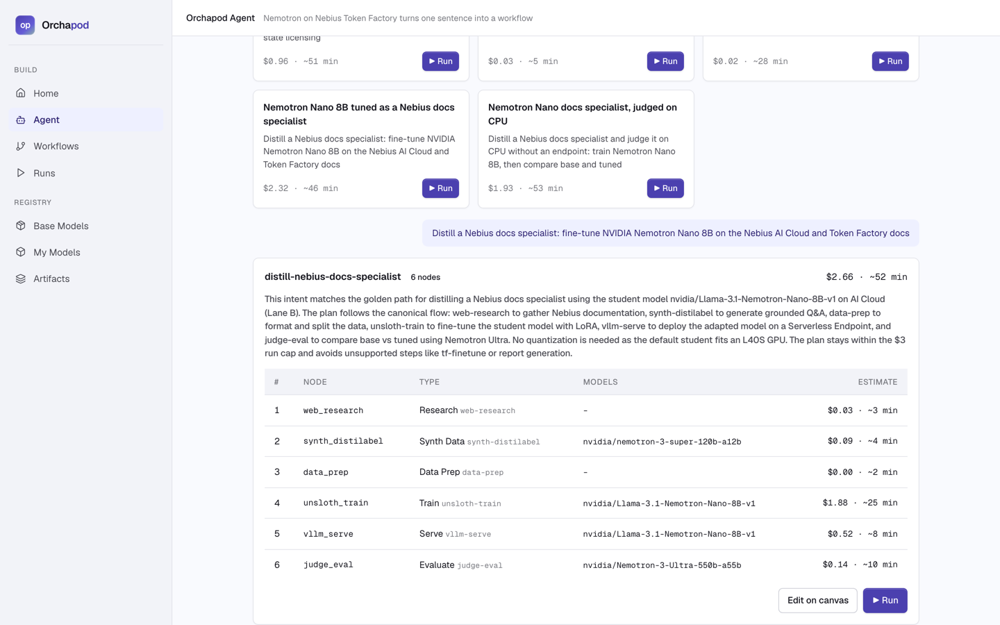
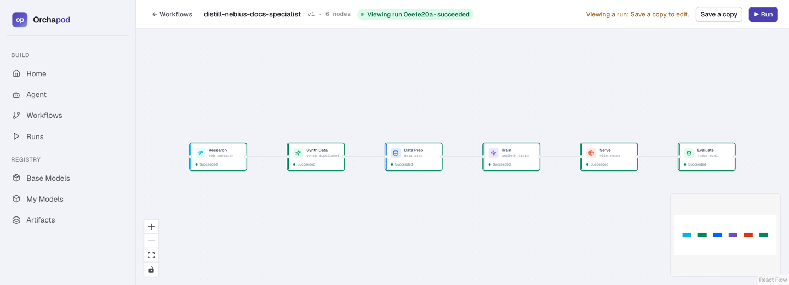
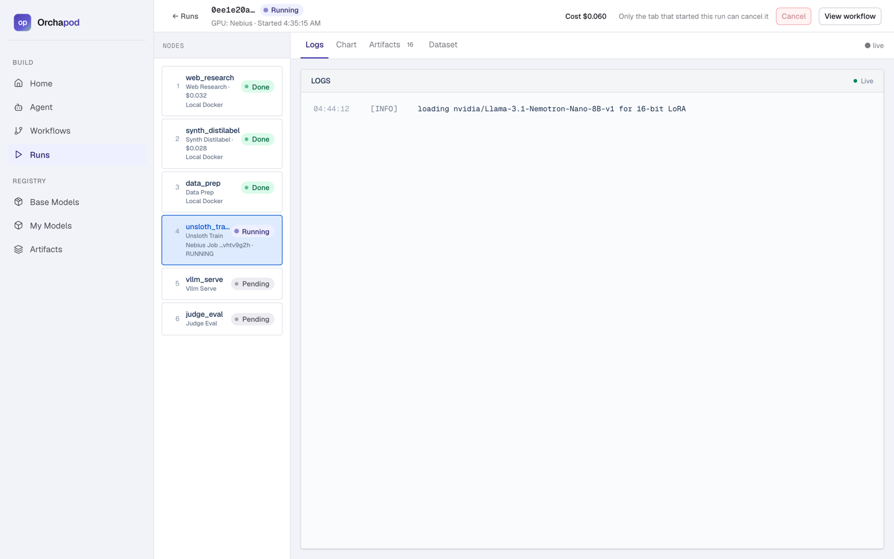
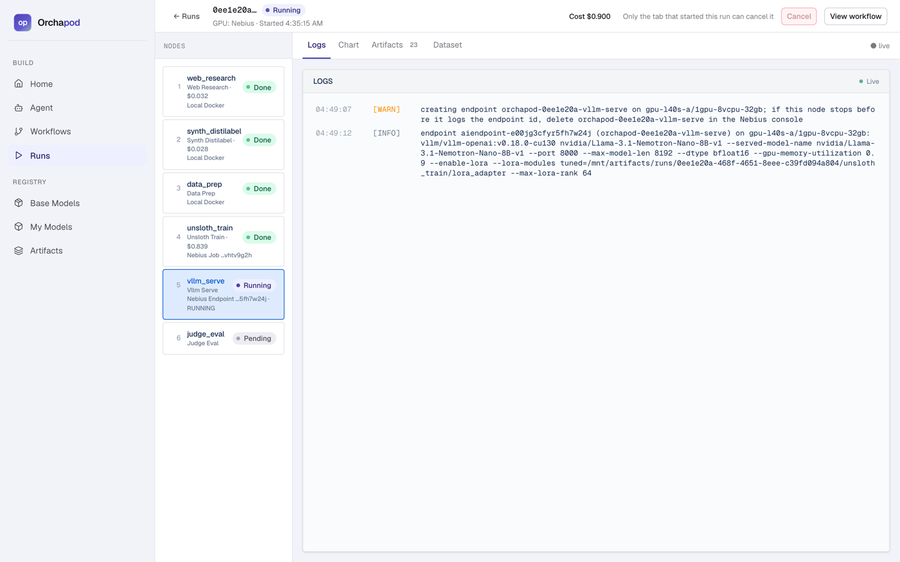
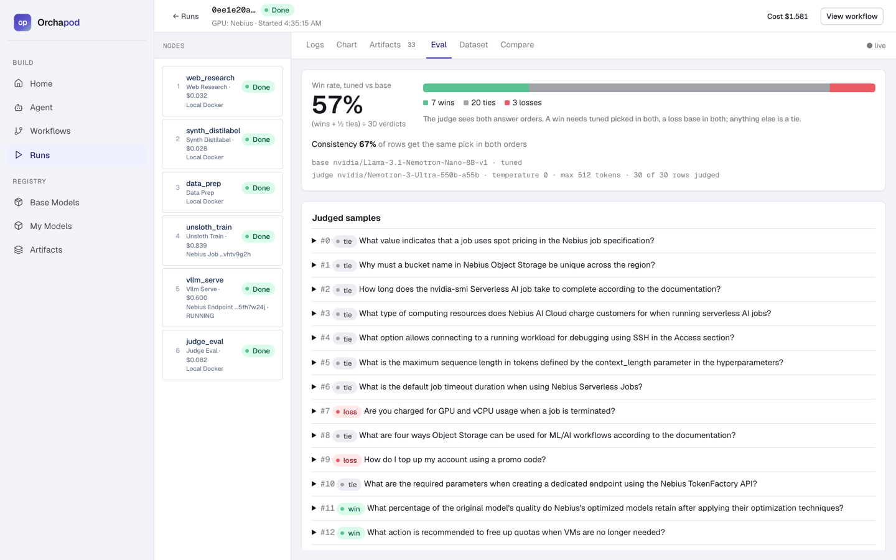
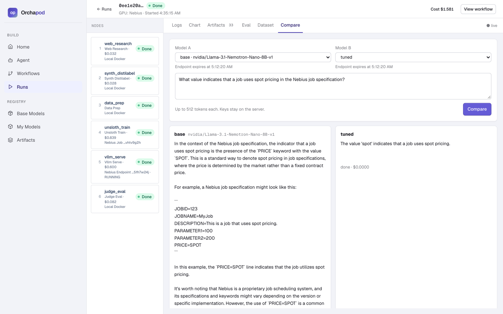
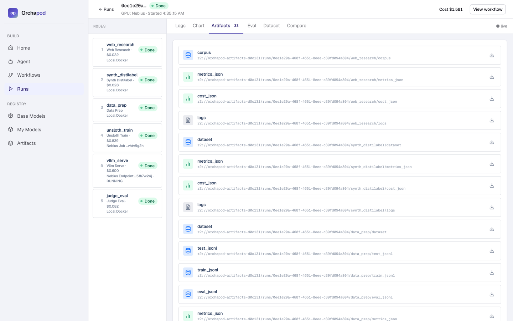

# Orchapod.ai

> Describe the specialist model you want in one sentence. Orchapod plans the pipeline, runs it on Nebius with NVIDIA Nemotron, evaluates the result against its base model and shows what it cost.

[](LICENSE)

An entry in the **Nebius × NVIDIA Global AI Hackathon**, track **Best Apps and Agents**. It runs on **Nebius Token Factory** and **Nebius AI Cloud**, calls **NVIDIA Nemotron** models at runtime and uses **Tavily** for web research.

**Status (2026-10-25).** The golden path has run live twice on the hosted demo, https://app.orchapod.dev: NVIDIA's Nemotron Nano 8B was trained on an H100 and served on an L40S on Nebius, then judged by Nemotron 3 Ultra. The runs took 24.2 and 23.5 min and cost $1.61 and $1.58 (Results). Intents #2 and #3 have run live too, and on deterministic stubs (no key, $0) the three canonical intents and the golden path pass end to end; [Setup](#setup) runs them on your machine. TODO(D8): the 3-minute video and the Devpost link; then this note goes.

## What it is

Orchapod is an open-source platform for the whole post-training lifecycle of a language model: research, synthetic data, fine-tuning, deployment, evaluation and side-by-side comparison. It has two front doors:

- **The Orchapod Agent** (`/agent`). Type one sentence. Nemotron 3 Super drafts a pipeline from the node catalog, the server validates it against the model and cost rules, and a plan card shows the nodes, the models and the estimated dollars and minutes. Press Run and Orchapod executes the plan, streams logs and cost, evaluates the result and writes a report. Or skip the typing: a template card runs a ready-made plan in one click.
- **The canvas.** Drag nodes onto a React Flow canvas. The YAML workflow is the source of truth, and any plan the Agent writes opens on the canvas for editing.


*Super's live plan for the golden sentence on the hosted app: six nodes, $2.66, no errors (rehearsal run 0ee1e20a).*


*The same plan on the canvas, each node coloured by its status in run 0ee1e20a. The public template gallery is [here](docs/img/templates.png).*

A finished run shows what it made: an eval view (win rate; wins, ties and losses; the judge's consistency between the two answer orders; exact match where it applies; every judged sample with the judge's reasoning in both orders), a dataset card (download link and per-field stats) and, when the run serves a model, a compare playground that streams one prompt to the base and tuned models side by side.

Three intents define "done"; each must run from the chat box with no manual edits, and each has a template card. Two more cards distil a Nebius docs specialist, the golden path: the fourth serves the tuned student from a GPU endpoint, the fifth judges it on CPU without one.

| Intent | Template card | What the Agent plans |
| --- | --- | --- |
| "Create a fine-tuned Llama 3B over all the real estate compliance in USA." | **Llama 3B tuned on US real-estate compliance** | web-research → synth-distilabel (grounded Q&A) → data-prep → tf-finetune (Llama 3.2 3B) → vllm-serve (base and adapter on one Serverless Endpoint; not run live yet) → judge-eval (base vs tuned) → report |
| "Create synthetic data of movie likes, shares and subscribes." | **Synthetic movie likes, shares and subscribes** | synth-distilabel (structured rows) → data-prep (validate, dedupe, stats) → dataset with a download link. No training, and the plan says so |
| "Quantize a model which is an expert in maths." | **A maths expert quantized to GGUF** | hf-download (Qwen2.5-Math-1.5B-Instruct) → quantize (GGUF q4_k_m on CPU, keeping the f16 GGUF as the baseline) → data-prep (50 GSM8K test questions) → judge-eval (f16 vs q4_k_m: exact match on all 50, Nemotron 3 Ultra judges 20) → report |
| "Distill a Nebius docs specialist: fine-tune NVIDIA Nemotron Nano 8B on the Nebius AI Cloud and Token Factory docs" | **Nemotron Nano 8B tuned as a Nebius docs specialist** | web-research (20 Nebius docs pages) → synth-distilabel (grounded Q&A) → data-prep → unsloth-train (Nemotron Nano 8B, 16-bit LoRA on an H100 Serverless Job) → vllm-serve (base and adapter on one L40S Serverless Endpoint) → judge-eval (base vs tuned) → report |
| "Distill a Nebius docs specialist and judge it on CPU without an endpoint: train Nemotron Nano 8B, then compare base and tuned" | **Nemotron Nano docs specialist, judged on CPU** | web-research (the same 20 pages) → synth-distilabel (grounded Q&A) → data-prep → unsloth-train (Nemotron Nano 8B, H100 Serverless Job) → quantize (the student to GGUF q4_k_m, its adapter to a GGUF LoRA) → judge-eval (llama.cpp on CPU: the GGUF against the GGUF plus the LoRA; not run at 8B yet) → report |

## Why

Every team wants a cheaper, faster, private specialist model. Today that takes an ML engineer and a pile of GPU plumbing. Orchapod turns it into a costed, capped and observable workflow.

- **NVIDIA end to end on the golden path.** Nemotron 3 Super plans, writes the synthetic data and writes the report. Nemotron 3.5 Lightning can filter the data. Nemotron 3 Ultra judges. The student is NVIDIA's `nvidia/Llama-3.1-Nemotron-Nano-8B-v1`: Unsloth trains it on a Nebius Serverless Job, and vLLM serves it from a Serverless Endpoint, so every model call runs on Nebius. The CPU variant differs: it serves the student with llama.cpp on the API host. The other templates are not NVIDIA end to end: real estate fine-tunes Llama 3.2 3B on Token Factory (Lane A), because its intent names Llama 3B, and maths quantizes Qwen2.5-Math-1.5B-Instruct.
- **It makes models, not only calls them.** Nemotron teaches and judges new specialist models, and every one is measured against its base.
- **An evaluation you can trust.** Base and tuned models get identical prompts and decoding. A Nemotron Ultra judge sees the question, the reference answer and the source passage, and scores the two answers in both orders; a win counts only if it holds in both. Fine-tuning moves style, format and vocabulary more than it injects facts, so answers are short and sourced. On two live golden runs, Ultra judged 30 held-out questions each: the tuned model won 7, lost 1 or 3, and tied the rest. The win rates were 0.60 and 0.57 (Results).
- **Cost is a first-class output.** Every billed call (tokens, Tavily credits, GPU hours) is metered per node, estimated before a run and capped during it.

## How it works

A typical run: research the topic, generate grounded synthetic data, prepare the splits, fine-tune and serve, judge the tuned model against its base, compare side by side. The fine-tune-and-serve step has two lanes, and a plan can take either without changing the rest:

- **Lane A** fine-tunes a Llama model on Token Factory. `vllm-serve` serves the adapter beside its base on one Serverless Endpoint, because Token Factory's per-token LoRA deploy is retired (spike 1 got 410). The real-estate template takes this lane.
- **Lane B**, the golden path, trains NVIDIA's Nemotron Nano 8B student with Unsloth on a Nebius Serverless Job and serves it from a Serverless Endpoint. The live golden run did both on Nebius (Results).

| Node | Runtime | What it does | Calls |
| --- | --- | --- | --- |
| `web-research` | cpu | queries or seed URLs → deduplicated passages of 200 to 2,000 characters with their source URLs | Tavily Search and Extract |
| `synth-distilabel` | cpu | synthetic data: self-instruct, evol-instruct, magpie, grounded Q&A from passages, or rows that match a JSON Schema | Nemotron 3 Super |
| `data-prep` | cpu | validate, exact and near dedupe, optional quality filter, seeded train / eval / test split stratified by source URL, so each source's rows spread across the splits | Nemotron 3.5 Lightning (filter) |
| `tf-finetune` | api | LoRA fine-tune, best checkpoint by validation loss, loss curve | Token Factory fine-tuning |
| `unsloth-train` | gpu | 16-bit LoRA with Unsloth on a Nemotron student, resumable checkpoints | Nebius Serverless Job |
| `vllm-serve` | api | creates a vLLM endpoint for the base model and the adapter side by side, registers its expiry and exits; the endpoint rents a GPU, so the public caps treat it as a GPU node | Nebius Serverless Endpoint |
| `judge-eval` | api | base vs tuned on held-out questions: identical decoding, a reference-guided judge, both answer orders; GGUF files are served locally by llama.cpp | Nemotron 3 Ultra |
| `hf-download` | cpu | Hugging Face model download with SHA-256 verification | Hugging Face Hub |
| `quantize` | cpu | GGUF q4_k_m, q5_k_m or q8_0 on CPU, optionally keeping the f16 GGUF as a baseline (AWQ needs a GPU job) | llama.cpp |

`cpu` and `api` nodes run as local containers (`api` nodes only call remote services); `gpu` nodes run as Nebius Serverless Jobs. `distill-sft`, `lm-eval` and the retired `tf-deploy` (Token Factory's per-token LoRA deploy answers 410) also exist, but the Agent never plans them. A test keeps this table's nodes and runtimes equal to `NODE_REGISTRY` in `packages/workflow_schema/models.py`.

Under the hood:

- **Control plane** (`apps/api`): FastAPI and SQLModel on Postgres, Redis pub/sub feeding a WebSocket for live events, a DAG executor, the budget guard and the Agent (planner, validator, reporter).
- **One container per node** (`containers/<node>/`). The executor passes a node its inputs as JSON in `ORCHAPOD_NODE_INPUTS`; the node writes outputs through the SDK to S3-compatible storage at `r2://<bucket>/runs/<run_id>/<node_id>/<name>` and exits 0 or non-zero. The node contract is [docs/NODE_CONTRACT.md](docs/NODE_CONTRACT.md), and every interface is pinned in [docs/contracts.md](docs/contracts.md).
- **Metering.** The node SDK (`packages/sdk-py`) records each billed call and writes `cost_json`, `metrics_json` and the node's log lines per node; the run page rolls them up.
- **Providers** (`packages/providers`): one retrying client per service (Token Factory, Tavily, Nebius Serverless) and a LocalDocker provider for CPU and API nodes. `STUB=1` replaces every external call with a deterministic stub.
- **Web** (`apps/web`): Next.js 15, React 19 and React Flow; the run page shows the node timeline, live logs, cost, artifacts and the fine-tune's loss curve, and a finished run's eval, dataset and compare tabs.

## How we use Nemotron, Token Factory, Nebius AI Cloud and Tavily

### Nemotron on Nebius Token Factory

A run planned from a sentence starts with a Nemotron call (the plan); a run started from a template skips it. The nodes make their own calls. When the run ends, Nemotron 3 Super writes the report once, in the background, titled `## <plan>: <status>`: one call of at most 30 s, with thinking off. A deterministic template writes it instead when `STUB=1` is set or that call fails. Spike 2 measured about 2 s per report on Super, against 16–110 s on Nemotron 3.5 Lightning. All calls go to `https://api.tokenfactory.nebius.com/v1` (OpenAI-compatible, key `NEBIUS_API_KEY`) through one client that retries, prices every call from a single table, refuses to send our key to any other host and honours `STUB=1`.

| Role | Model id | Where |
| --- | --- | --- |
| Planner | `nvidia/nemotron-3-super-120b-a12b` | Orchapod Agent: guided-JSON plan from the node catalog, up to two repair rounds |
| Teacher | `nvidia/nemotron-3-super-120b-a12b` | `synth-distilabel`: grounded Q&A, structured rows, self-instruct, evol-instruct, magpie |
| Judge | `nvidia/Nemotron-3-Ultra-550b-a55b` | `judge-eval`: base vs tuned, reference-guided, both answer orders |
| Quality filter | `nvidia/Nemotron-3_5-Lightning` | `data-prep`: optional, scores each chat row 1 to 5 and drops rows below 3; the node fails if more than max(2, a tenth) of its scoring calls fail |
| Reporter | `nvidia/nemotron-3-super-120b-a12b` | Orchapod Agent: writes the run report when the run ends (what ran, metrics, cost against the estimate) |

No other model provider is called: the Anthropic and OpenAI code paths (the planner's Claude path, the synthetic-data teacher branches and the evaluation's judge fallback) were deleted during the build, and the executor forwards no other model provider's key to the node containers.

### Token Factory fine-tuning (Lane A)

`tf-finetune` uploads the train and validation files, creates a LoRA job, polls it, keeps the checkpoint with the lowest validation loss and saves the adapter and the loss curve. Token Factory no longer deploys LoRA adapters per token (spike 1: `POST /v0/models` answers 410), so `vllm-serve` serves the adapter beside its base on one Serverless Endpoint. Token Factory fine-tunes Llama, Qwen, gpt-oss, DeepSeek and Gemma models but not Nemotron, so Lane A tunes a Llama model (3.2 3B or 3.1 8B) that Nemotron teaches and judges.

Spike 1 fine-tuned `meta-llama/Llama-3.1-8B-Instruct` (the id the API accepts; `Meta-Llama-3.1-8B-Instruct` gets 422) but found no published price per trained token, so the client refuses to start an unpriced job until the rate is known.

### Nebius AI Cloud (Lane B)

- **Serverless Jobs.** `unsloth-train` runs as a Job on `gpu-h100-sxm` with a 1-hour timeout: Unsloth trains a 16-bit LoRA on `nvidia/Llama-3.1-Nemotron-Nano-8B-v1`. The docs templates set `merge: false`, so training skips the 16 GB merged copy. A spike on a rented A100 outside Nebius chose that student: 60 steps took 62.5 s at a 15.9 GiB peak, and the merged model served from vLLM 0.18.0. Logs and artifacts flow back through the SDK, so `ORCHAPOD_CONTROL_URL` must be a public https URL: both live golden runs ran from the hosted API. Their Jobs took 11.2 min each, of which the image pull took about 6 min and then 4.6 min.
- **Serverless Endpoints.** `vllm-serve` creates an Endpoint (`vllm/vllm-openai:v0.18.0-cu130`, default `gpu-l40s-a`, bearer-token auth) that serves the base model and the adapter side by side, so Nemotron 3 Ultra judges the tuned model pairwise against its base. It registers an expiry (15 minutes in the docs template, 30 by default), at which the control plane deletes it. On both live golden runs, base and adapter served side by side on one L40S (`--enable-lora`); the endpoint took about 4 min from provisioning to running, and the API deleted it at expiry.
- **Object Storage.** Datasets, checkpoints and artifacts live in an S3-compatible bucket: `https://storage.eu-north1.nebius.cloud` on Nebius, where the hosted app's bucket sits in eu-north1 beside the GPUs, and MinIO locally. The `ORCHAPOD_R2_*` variables and the `r2://` scheme keep their historical names.
- **Container Registry.** The hosted app's node images live in a Nebius Container Registry in the same project, so Jobs pull them with no credentials.

We have no Nebius console screenshots. The run page's node cards show each Job and Endpoint and its live state instead:


*Run 0ee1e20a while the student trains: the node card shows the Nebius Job and its live state, RUNNING.*

### Tavily

`web-research` calls Tavily Search (advanced depth, with raw content) and Extract, splits the pages into passages of 200 to 2,000 characters with their source URLs, and meters credits at $0.008 each. The passages ground the synthetic Q&A, so every grounded answer carries its source URL. On the golden run it read 20 Nebius docs pages in 3 s for $0.032 (4 credits).

## Setup

You need Docker with the compose plugin, Python 3.12 (`brew install python@3.12` or `uv python install 3.12`) and Node 22 with pnpm. Live runs also need a [Nebius Token Factory](https://tokenfactory.nebius.com) API key and a [Tavily](https://tavily.com) API key (free tier: 1,000 credits a month); a first run needs neither. A live run of the real-estate template also needs `HF_TOKEN`, from a Hugging Face account that accepted Meta's Llama licence, because Meta's base models are gated. The Nemotron Nano golden path needs none. The repository is private until the hackathon freeze, so until then the clone needs read access (TODO(G3)).

```bash
git clone -b NebiusHackathon https://github.com/bangadpurva/orchapod.ai.git
cd orchapod.ai
cp .env.example .env
make up                         # Postgres on 5432, Redis on 6379, MinIO on 9000 (console 9001)

python3.12 -m venv .venv && . .venv/bin/activate
pip install -r requirements-dev.txt -r apps/api/requirements.txt
make check                      # ruff + unit tests + web tests; no keys, no spend
```

`make up` publishes those four ports, so stop anything already listening on them first. On pnpm 9 (as in CI), run `make check PNPM=pnpm`.

**A first run without keys.** `python scripts/e2e_agent.py --stub` builds the node images it needs and runs the three canonical intents and the golden path through the Agent API on deterministic stubs, for $0. Each intent is planned, run and reported. The golden path posts template 4's full plan straight to `/agent/run`, and its `unsloth-train` image is a small stub stage, not the 20 GB CUDA image. The first time, the setup and this run download about 1.8 GB in all (the Postgres, Redis and MinIO images, the nodes' base images, and the pip and pnpm packages) and use about 7 GB of disk after the image builds. Each image build may take 600 s, pulls included, so a slow link can time out on `quantize`. With warm caches, a fresh clone reached a green `make check E2E=1` in 3 min 35 s (`hackathon/briefs/2026-10-25-qa-w11-report.md`).

`make check E2E=1` runs it after `scripts/e2e_demo.py --stub` (intent #2 through the workflow API), and both are strict: a failed intent, or a canonical plan that names a node that does not exist, fails them. They start their own API with `STUB=1` and a throwaway database, need `make up`, and rebuild the local `orchapod/<node>:dev` images. Their API listens on 127.0.0.1, which node containers reach through Docker Desktop (macOS, Windows) but not on Linux; there, set `E2E_BIND_HOST` to Docker's bridge gateway (usually 172.17.0.1) on a throwaway machine, never the hosted VM (not yet tried on Linux). Recorded on a fresh clone on 2026-10-25 @ 0524d82: `make check` passed 1171 tests and 50 web tests, and `make check E2E=1` exited 0 with `4 PASS` in 121 s (`hackathon/briefs/2026-10-25-qa-w11-report.md`).

**The app.** Two lines of `.env` decide what your browser can do:

- `STUB=1` runs every node on deterministic stubs with no key. The planner is a stub too: it answers with the template whose intent and title share the most words with your sentence. So any sentence gets one of the five plans, and one that shares no word gets the real-estate plan. Left blank, as shipped, the API needs `NEBIUS_API_KEY` and `TAVILY_API_KEY`, and without the first `POST /agent/plan` answers 503 "NEBIUS_API_KEY is not set".
- `ORCHAPOD_ANON_SCALE=1` gives you the full caps. The web app never sends the admin header, so every browser is a public visitor, and the shipped 0.1 scales the caps down to a visitor's: $0.30 a run, $1.50 a day, no node that rents a GPU, and Run disabled on the three fine-tune templates: only the movie and maths templates fit.

Then start the API and the web app in two terminals; the API creates its tables and its bucket itself.

```bash
# terminal 1: the API on :8001 (docs at http://localhost:8001/docs)
. .venv/bin/activate
set -a; . ./.env; set +a
PYTHONPATH=apps:packages/sdk-py uvicorn api.main:app --port 8001 --timeout-graceful-shutdown 3  # so one Ctrl-C stops it after a run

# terminal 2: the web app on http://localhost:3000, which calls the API on :8001
cd apps/web
pnpm install                                    # pnpm 11 ends with ERR_PNPM_IGNORED_BUILDS (sharp): harmless
pnpm --config.verify-deps-before-run=false dev  # without the flag, pnpm 11 reruns that install and stops
```

If port 8001 is taken, pick another, say 8061. Run uvicorn with `--port 8061`, and set `ORCHAPOD_CONTROL_URL=http://localhost:8061` in `.env` before you load it. Start the web app with `NEXT_PUBLIC_API_URL=http://localhost:8061 NEXT_PUBLIC_WS_URL=ws://localhost:8061` in front of its `pnpm` command. Node containers report to `ORCHAPOD_CONTROL_URL`, so a wrong one makes every run fail at its first node, with a `ConnectionRefusedError` in that node's log.

On Linux, add `--host 0.0.0.0` to the uvicorn line (it then listens on every interface): node containers reach the host through Docker's host gateway, which never reaches a listener on 127.0.0.1; Docker Desktop works as written. Open http://localhost:3000; `make down` stops Postgres, Redis and MinIO.

**Node images.** A node runs from `orchapod/<node>:dev` when that image exists locally; otherwise Docker pulls `ghcr.io/bangadpurva/<node>:latest`, which CI pushes from NebiusHackathon (forks set `ORCHAPOD_IMAGE_PREFIX`). Those packages refuse anonymous pulls until they are made public (TODO(G3)). The hosted app pulls from our own Nebius Container Registry instead, which only our project can read. So build the images first: the stub run above builds the images of the three canonical intents and the golden path, or build them yourself from the repo root, for example for the movie data:

```bash
for n in synth-distilabel data-prep; do docker build -t orchapod/$n:dev -f containers/$n/Dockerfile .; done
```

The other templates need `hf-download quantize data-prep judge-eval` (maths), `web-research synth-distilabel data-prep tf-finetune vllm-serve judge-eval` (real-estate), `web-research synth-distilabel data-prep unsloth-train vllm-serve judge-eval` (Nebius docs) and `web-research synth-distilabel data-prep unsloth-train quantize judge-eval` (Nebius docs, judged on CPU). `unsloth-train` (Lane B) is an amd64 CUDA image of about 20 GB; build it only for GPU runs. Stub runs build its small first stage instead (`--target stub`), which runs only on stubs.

**GPU nodes (Lane B)** also need a Nebius AI Cloud project with billing and GPU quota, `ORCHAPOD_ENDPOINT_TOKEN` for `vllm-serve`, a public https `ORCHAPOD_CONTROL_URL` and Nebius Object Storage (an https `ORCHAPOD_R2_ENDPOINT`, since Nebius cannot reach a local MinIO); `.env.example` lists every variable and where to get it. A Job pulls its node image from a registry, not from your machine: push the images to a Nebius Container Registry in your project and set `ORCHAPOD_IMAGE_PREFIX` to it, and Jobs pull them with no credentials.

## Run the demo

- **Hosted.** https://app.orchapod.dev, with its API at https://api.orchapod.dev. It holds both live golden runs: [d20d30f3](https://app.orchapod.dev/runs/d20d30f3-768f-4989-b974-cac3d9b47495) and the rehearsal typed on its /agent page, [0ee1e20a](https://app.orchapod.dev/runs/0ee1e20a-468f-4651-8eee-c39fd094a804). Their run pages show the nodes, their costs and logs, and the eval view. Its template cards run the pipeline at reduced scale under the public caps, so a visitor can run the movie and maths templates (Costs and caps). It runs on one Nebius VM in eu-west1 with Docker Compose and Caddy for HTTPS ([docs/HOSTING.md](docs/HOSTING.md)); its bucket and GPUs are in eu-north1.
- **Locally, from the Agent.** With no key, set `STUB=1` in `.env` first. Open http://localhost:3000/agent and type one of the intents above, or press Run on a template card (`GET /agent/templates`), which starts a reduced version of its plan (the same pipeline on fewer pages, rows and samples) in one click. A demo-mode banner gives the templates' estimates and says public runs are capped; a template whose reduced plan is above your per-run cap (`fits: false`) keeps Run disabled and links to its golden run. Read the plan card: nodes, models, estimated cost and minutes, warnings. Run stays disabled while the plan has errors, and Edit opens the plan on the canvas. Press Run to follow the live run view (node timeline, logs, cost meter). A run that succeeds opens its result, the eval view or the dataset card, and its compare tab streams one prompt to the run's base and tuned models side by side through `POST /compare`, with the keys kept on the server. When the run ends, the report card shows what ran, the metrics, the cost against the estimate and how to use the result. With `STUB=1` all of this runs on stubs at $0.
- **Run page.** `/runs/{id}` (also embedded on `/agent`) shows per-node status, cost and errors from `GET /runs/{id}/summary`, updates the cost meter live, shows a failed node's error verbatim and offers **Retry node** while the run is failed or cancelled. Its chart tab draws the fine-tune's loss curve from the node's metrics, so a finished or seeded run shows it, and appends live progress. Each node card says where the step runs: Local Docker, or a Nebius Job or Endpoint with its live state. The Logs tab keeps every node's lines after the run ends ([run 0ee1e20a's logs](docs/img/run-logs.png)), View workflow opens the canvas coloured by status, and a run the Agent started has a Report tab ([its report](docs/img/run-report.png)).


*Run 0ee1e20a mid-run: the Nebius Endpoint is RUNNING, and its log shows vLLM serving the base and the LoRA.*

- **Headless.** `python scripts/e2e_agent.py --stub` runs the three canonical intents and the golden path through the Agent with no key (Setup). `make demo` seeds the live golden run, `d20d30f3`, into the database and bucket that `.env` names, so load `.env` first (`set -a; . ./.env; set +a`). Without it, `make demo` seeds a local SQLite file that the API never reads. Then, with the API and the web app from "The app" running, open http://localhost:3000/runs/d20d30f3-768f-4989-b974-cac3d9b47495: its run page, eval view and report render without a model call.
- **Live, headless.** `make agent-e2e INTENT=2 MAX_COST=0.5` runs one canonical intent through the Agent API with real Token Factory calls. Load `.env` and run `make up` first. It needs `NEBIUS_API_KEY` and stops at `MAX_COST` (at most $3). It refuses a plan that needs an unset key (web-research needs `TAVILY_API_KEY`). It refuses plans that rent a GPU; the golden run is `make e2e API=https://api.<domain>`, which runs template 4 on the hosted API as the admin (`ORCHAPOD_ADMIN_TOKEN`), capped at `MAX_COST` (default $3) and 120 minutes, because Nebius Jobs report to a public https control URL. The first live golden run, `d20d30f3`, passed this way on 2026-10-25, and intents #2 and #3 passed through `make agent-e2e` (Results).

### Results

**Two live golden runs (2026-10-25, hosted).** The same pipeline ran twice, and the results agree within noise. The tuned model beats its base on 7 of 30 held-out questions and loses on 1 or 3; most pairs tie. Both runs are reported as they are.

| Run | Date | Wall time | Cost (estimate) | Wins / ties / losses | Win rate | Consistency |
| --- | --- | --- | --- | --- | --- | --- |
| `d20d30f3`, the first live golden run | 2026-10-25 | 24.2 min | $1.61 ($2.66) | 7 / 22 / 1 | 0.60 | 0.73 |
| `0ee1e20a`, the D8 rehearsal, typed on /agent | 2026-10-25 | 23.5 min | $1.58 ($2.66) | 7 / 20 / 3 | 0.57 | 0.67 |

| Step | What ran | `d20d30f3` | `0ee1e20a` |
| --- | --- | --- | --- |
| research | Tavily, 20 Nebius docs pages | 3 s, $0.032 | 3 s, $0.032 |
| synth | Nemotron 3 Super, 300 grounded Q&A rows | 2.1 min, $0.0295 | 153 s, $0.028 |
| prep | data-prep | 3 s | 4 s |
| train | Unsloth LoRA of Nemotron Nano 8B on an H100 Serverless Job | 11.2 min, $0.8408 | 671 s, $0.839 |
| serve | vLLM 0.18 on one L40S Serverless Endpoint, base + LoRA via `--enable-lora` | 9.3 min, $0.6276 | 495 s, $0.600 |
| evaluate | Nemotron 3 Ultra, pairwise judge | 85 s, $0.0802 | 85 s, $0.082 |

- **Train.** The image pull from our Nebius Container Registry took about 6 min, then 4.6 min. Both runs did 60 of 60 steps. The loss fell from 7.75 to 1.68 (validation 1.63), then from 7.20 to 1.31 (validation 1.82): [the second run's loss chart](docs/img/loss-chart.png).
- **Evaluate.** Ultra judged 30 held-out questions in each run, with 0 errors. Consistency is the share of verdicts that held in both answer orders.
- **One win (d20d30f3).** Asked "What happens to computing resources and container disk when a Serverless AI job completes?", the base model answered generically. The tuned model said: "When a Serverless AI job completes, the container disk is automatically deleted, and the computing resources are released."
- **The playground (0ee1e20a).** Inside the endpoint's keep-alive, held-out sample #0, fixed as the question before the run, went to both models. The tuned model said "The value 'spot' indicates that a job uses spot pricing."; the base model invented a `PRICE=SPOT` format. The reference uses a `pricingModel` field instead, so the judge scored this pair a tie ([the judged sample](docs/img/eval-sample.png)).
- **The first attempt** (`fa20d166`, $0.58) failed in train: the image's Mamba-2 wheels broke `import unsloth` on a GPU. The fix (69cafd1) drops them, so the image no longer trains NemotronH students.
- TODO(D8): the video link.


*Run 0ee1e20a's eval view: 7 wins, 20 ties and 3 losses on 30 held-out questions; win rate 57%, consistency 67%.*


*The playground inside run 0ee1e20a's keep-alive: held-out sample #0, base and tuned side by side (the judge scored this pair a tie).*

- **Live: intent #2 through the Agent (2026-10-22).** Nemotron 3 Super planned `movie-interactions-synthetic` live: synth-distilabel → data-prep, estimated at $0.30 and 9 minutes. Run `84e57f84-5423-4c3e-9f68-073c73eb2224` succeeded in 446 s. It returned 928 rows with exactly the schema's fields, and Super wrote the report. It cost $0.1007 in all: $0.0966 for the run and $0.0041 for the planner and the reporter.
- **Live: intent #3 through the Agent (2026-10-22).** It passed on the second attempt. The first (run `cf49d0f1`) failed in 73 s for $0.0034, because Super's live plan left out GSM8K's dataset config. data-prep now picks `main` (else the first config) when a dataset has several, and logs a warning. The passing run, `59786797-26ca-4a01-9b80-80a730234a97`, took 255 s and $0.0175 in all. It downloaded a 3.1 GB maths model and quantized it to a 0.99 GB q4_k_m GGUF in 75 s on CPU. Nemotron 3 Ultra judged q4_k_m against f16 live on 5 questions: 1 win, 4 ties, 0 losses, consistency 1.0. Exact match was 0.8 for q4_k_m and 0.6 for f16, a gap of one question. Five judged questions is a smoke-scale sample, not a measure of quality.
- **Intent #3 on CPU (measured, no key).** The maths template's evaluate step ran in Docker on an M1 Pro Mac, a busy host, with the judge turned off: the f16 and q4_k_m GGUFs of Qwen2.5-Math-1.5B-Instruct answered the 50 GSM8K test questions in 18 min 01 s in all, with no failed row. Exact match was 0.78 for f16 and 0.84 for q4_k_m, a gap of 3 questions in 50 that is within noise. The q4_k_m file is 0.99 GB, against 3.09 GB for f16.
- **Stub runs ($0, no key).** Both checks run the real API, executor and node containers on deterministic stubs. On 2026-10-22, on NebiusHackathon @ 3b7bf07, `make check E2E=1` gave `4 PASS`: intents 1 to 3 and the golden path, whose full plan (template 4) ran in 8 s for $0 against its $2.66 estimate (run 298cf7be). `make ui-smoke`, the Playwright smoke of the web app, passed 5 of 5. Its golden-path test clicks template 4's card, which runs the reduced plan, through the run, the eval view and the compare playground. Another test is the public-cap check: at `ORCHAPOD_ANON_SCALE=0.1`, a template above the per-run cap cannot be run and says why. Both are in `hackathon/LOG.md` (2026-10-22T07:27Z).

## Costs and caps

| Cap | Default | Setting |
| --- | --- | --- |
| Per run | $3 | `ORCHAPOD_MAX_RUN_USD` |
| Per UTC day | $15 | `ORCHAPOD_MAX_DAY_USD` |
| Serverless Job timeout | 1 hour | fixed |
| Node backstop timeout | 5,400 s | `ORCHAPOD_NODE_TIMEOUT_S` |
| Endpoint keep-alive | 30 min (15 in the docs template), at most 120 (the API deletes the endpoint at expiry, as it did on both live golden runs) | `keep_alive_min` on `vllm-serve` |
| Compare streams in flight | 4 | `ORCHAPOD_MAX_COMPARES` |
| Kill switch | off | `ORCHAPOD_KILL_SWITCH=1` |
| Anonymous visitors | caps × 0.1 | `ORCHAPOD_ANON_SCALE` |

The guard checks the estimate when a plan is drafted (`POST /agent/plan` answers 402 once the day's budget is spent, and an estimate above the remaining budget is a plan error, which the planner tries to repair), at /agent/run, start and retry (HTTP 402), at every node boundary, and inside each node, where `ORCHAPOD_MAX_COST_USD` aborts the node once spend passes it. A visitor's plan with a node that rents a GPU is the exception: it comes back as drafted, with no budget repairs, and `admin_only` names those nodes. Its error says they "rent GPUs billed by the hour: on the public demo only the admin can start them", and the page shows it as an amber "Admin-only on the public demo" note, with a link to the pipeline's golden run when there is one. A model with no price in the table fails before the request is sent. No live run has hit a cap yet: the two golden runs spent $1.61 and $1.58 of their $3.

**The public app.** The web app never sends the admin header (`X-Orchapod-Admin` with `ORCHAPOD_ADMIN_TOKEN`), so every browser gets the caps × `ORCHAPOD_ANON_SCALE`: by default $0.30 a run and $1.50 a day. Visitors cannot start a node that rents a GPU (`unsloth-train`, `vllm-serve`: HTTP 403), cannot change or delete a workflow that has runs (409; the canvas then offers **Save a copy**, which saves the edits as a new workflow "<name> (copy)"), and can cancel only the runs they started: start and `/agent/run` return a cancel token once, the starting browser tab keeps it in sessionStorage and sends it as `X-Orchapod-Cancel-Token`, and in any other tab the run page disables Cancel (HTTP 403 without the token). Each address is rate-limited, with HTTP 429 and `Retry-After`: planning 5 requests, then 1 every 12 s; starting runs the same; compare 3, then 1 a minute; other writes 10, then 1 every 30 s. Secret-looking node inputs (keys, tokens, passwords) are dropped before a workflow or plan is stored, and artifact metadata is redacted on the way in and on every way out. The kill switch refuses every plan, run, start, retry and compare.

| Item | Price (2026-10-20) |
| --- | --- |
| Nemotron 3 Super, per 1M tokens in / out | $0.30 / $0.90 |
| Nemotron 3 Ultra, per 1M tokens in / out | $1.00 / $3.00 |
| Nemotron 3.5 Lightning, per 1M tokens in / out | $0.06 / $0.24 |
| Tavily, per credit | $0.008 |
| `gpu-h100-sxm`, per hour | $4.50 |
| `gpu-l40s-a`, per hour | $1.55 |

These are estimates, not measurements. The docs template (Lane B) is estimated at $2.66 at full scale. Under our spend rules its worst case is $2.92, still under the $3 run cap. That is at most 25 minutes of H100, up to 15 minutes of L40S start plus 15 of keep-alive, and about $0.27 of Tavily and Token Factory calls. Its CPU variant is estimated at $2.15. Lane A's estimates assume $0.50 for the fine-tune, because Token Factory does not publish its price per trained token (spike 1). Measured: the two live golden runs cost $1.61 in 24.2 min and $1.58 in 23.5 min against that $2.66 estimate, intent #2 $0.1007 in 446 s, and intent #3 $0.0175 in 255 s (Results).


*Run 0ee1e20a finished: each node's cost, $1.581 in all against the $2.66 estimate, and the run's artifacts.*

## What changed during the submission period

The submission period is Aug 26 – Oct 30, 2026. Orchapod predates it: its first commit is May 4, 2026 (367c605), and everything that existed before the period is what `git log --before=2026-08-26` shows. That includes the React Flow canvas and YAML workflow format, the FastAPI control plane and DAG executor, the node SDK, the data-prep, hf-download, unsloth-train, distill-sft, quantize, lm-eval and vllm-serve nodes, run pages with live logs, Try-it chat and an endpoint countdown, and a Vast.ai GPU provider that is not on the demo path.

During the period (the dated list is [CHANGELOG.md](CHANGELOG.md)):

- Oct 2–8: first Nebius × NVIDIA integration: a Token Factory service, a Nebius provider, the Nemotron 3 Super teacher node (`synth-distilabel`), Token Factory model ids verified against the live catalog, and the executor fixes that let a CPU workflow run end to end.
- Oct 20: the Orchapod Agent (one sentence in, a validated Nemotron plan with cost and time estimates out; runs monitored and reported; spend caps per run and per day); Tavily web research, grounded and structured synthetic data, and Token Factory fine-tune and deploy nodes (the deploy node was retired after spike 1); one Token Factory client and one Tavily client; a run engine with retry, cancel, restart recovery and cost roll-up; the Agent page and a run page with a live cost meter; the Lane B student chosen by experiment; repo clean-up, interface contracts ([docs/contracts.md](docs/contracts.md)) and a green `make check` in CI.
- Oct 21: the evaluation (Nemotron 3 Ultra judges base against tuned in both orders) and its eval view; intent #3's CPU quantization with an f16 baseline, plus a fix for llama.cpp garbling f16 answers on Apple silicon; the compare playground; four one-click templates with reduced "Run it yourself" versions; the data-prep quality filter; the Serverless Endpoint serving node and the GPU training container; public-demo hardening (rate limits, an origin allow-list, deep health checks, GPU nodes for the admin only, secret-looking inputs never stored); hosting files for one VM, not deployed yet; stub end-to-end tests of the three intents, a browser smoke test that runs a template card on stubs through to the eval view and the compare playground, and failure drills.
- TODO(D8): bring this list up to date with CHANGELOG.md at the freeze.

## License

[MIT](LICENSE). Open source, free to use and self-host.
